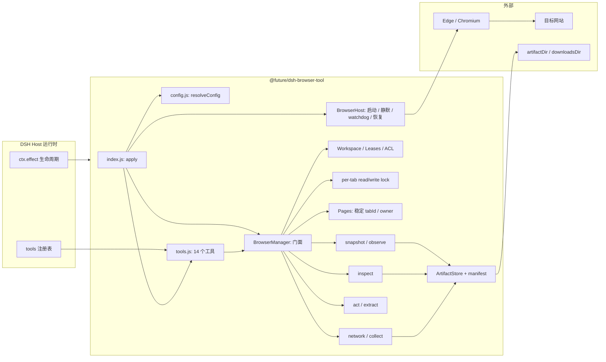
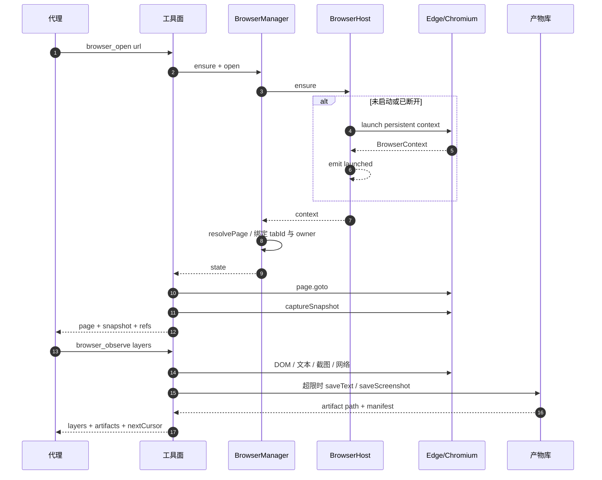
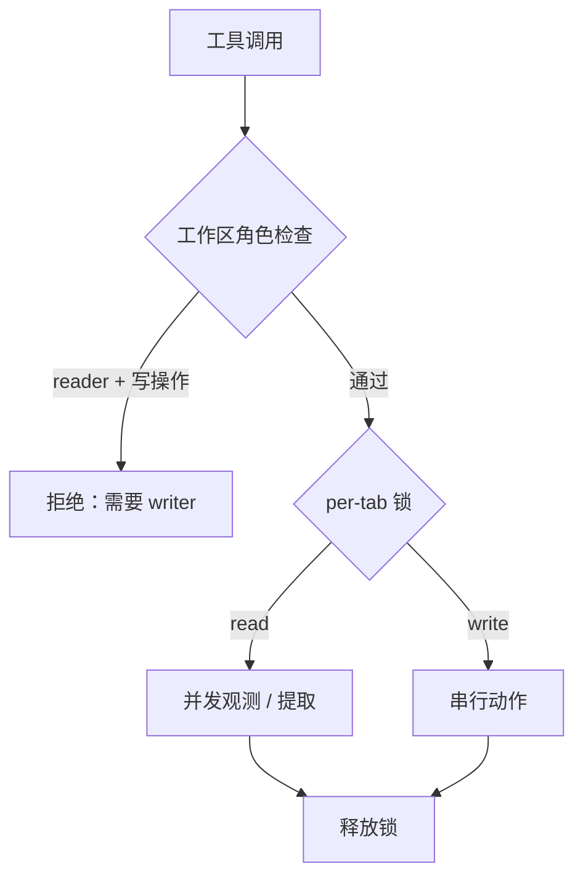

# 架构（architecture）

本文描述 `@future/dsh-browser-tool` v0.2 的架构。代码已落地；真实 Edge 端到端验收仍待 install-verify（见 [`install-verification.md`](install-verification.md)）。

## 设计原则

1. **浏览器是资产，不是会话**：`BrowserHost` 管理进程与 `BrowserContext`，生命周期独立于单次工具调用；空闲不关闭，崩溃可恢复。
2. **观测与动作分离**：先读实际状态，再操作，操作后回读；不做「盲点」。
3. **分层返回，按需扩读**：字符预算 + `offset` / `limit` / `nextCursor`，超限落盘，避免整页塞进上下文。
4. **显式权限**：工作区角色（reader / writer）、per-tab 读写锁、高风险能力（eval、越界产物路径）默认关闭。
5. **不抢焦点**：默认后台；可见性是显式选择，不是副作用。
6. **网页内容不可信**：工具输出统一加提示，模型不把页面文本当指令。

## 组件总览



| 层 | 职责 | 主要文件 |
|---|---|---|
| Host | 浏览器进程、可见性、断线恢复、watchdog、CDP | `lib/host.js` |
| Manager | 对工具面暴露的稳定门面：页面解析、工作区、锁、状态 | `lib/manager.js` |
| Workspace | 工作区成员、角色、租约、handoff | `lib/workspace.js` |
| Pages | 稳定 `tabId`、owner、活跃页、上限与回收 | `lib/pages.js` |
| Locks | 同页写串行、跨页并行、等待超时 | `lib/locks.js` |
| Observe | `structure` / `text` / `visual` / `network` / `console` / `meta` 分层观测 | `lib/observe.js`、`lib/snapshot.js` |
| Inspect | DOM / HTML / CSS / a11y / box / resources / scripts / storage / console / performance / eval | `lib/inspect.js` |
| Act | 动作执行、回读核验、`@eN` / selector / container / nth | `lib/act.js` |
| Extract | text / html / links / tables / labeled / structured / markdown / images / forms | `lib/extract.js` |
| Network | 请求/响应环形缓冲、HAR 导出 | `lib/network.js` |
| Collect | cursor + checkpoint 的可续跑批处理 | `lib/collect.js` |
| Artifacts | 产物路径约束、manifest JSONL、哈希 | `lib/artifacts.js` |
| Tools | JSON Schema、`isConcurrencySafe`、render、错误提示 | `lib/tools.js` |

## 启动与生命周期



生命周期要点：

- `apply(ctx, rawConfig)` 只做一次：归一化配置 → 构造 `BrowserManager` → 注册工具；`ctx.effect` 在卸载时 `dispose()`。
- `ensure()` 是懒启动：第一次工具调用才拉起浏览器，避免空跑。
- 事件：`launched`、`page`、`disconnected`、`recovered`。Manager 订阅这些事件维护 `tabId` 与工作区视图。
- `close(reason)` 释放配置目录锁，保留 `userDataDir` 中的登录态；CDP 模式只断开连接。
- 空闲计时：`idleCloseMs=0` 表示永不自动关闭；非 0 时由活动时间戳驱动。
- watchdog：默认每 30 秒检查 `browser.isConnected()` 与上下文页数；异常时记录 `lastError`，不主动杀进程。

## 锁与权限



- **模型**：每标签页一把读/写锁。多个 reader 可并发持有；writer 独占。不同标签页互不影响。
- **获取顺序**：工具层先 `assertAccess(agentId, tab, mode)` 校验工作区角色，再 `withTabLock(tabId, mode, fn)`。
- **权限**：工作区成员有 `reader` / `writer` 角色；reader 调用写动作抛「当前工作区角色为 reader，不能执行写操作」。
- **租约**：`join` / `grant` 产生带 `expiresAt` 的租约；过期后需要重新加入。`handoff` 把标签页 owner 转给另一个代理并写 `note`。
- **超时**：等待锁超过阈值返回明确错误，不无限阻塞模型。

## 崩溃恢复

1. `page` 或 `browser` 触发 `disconnected` → 标记 `connected=false`，记录 `reason`。
2. 下一次工具调用进入 `ensure()`：
   - 若 `autoRelaunch=true` 且本进程内尚未重试过 → 重新 `launch`，发出 `recovered({ attempt: 1 })`。
   - 只重试一次；再次失败抛出带中文提示的错误，要求用户检查浏览器/配置目录锁。
3. `browser_status` 返回 `restartCount`、`lastError`、`launchedAt`，便于定位。
4. `browser_collect` 的可续跑性不依赖浏览器进程：checkpoint 文件记录 `cursor` 与 `doneUrls`，重启后从断点继续。

## 产物账本

所有落盘产物经 `ArtifactStore`：

- 路径：相对路径基于 `artifactDir`；`allowAbsoluteArtifacts=false` 时拒绝越界绝对路径；`..` 归一化后再校验。
- 命名：`<prefix>-<timestamp>-<rand>.<ext>`，避免并发覆盖。
- manifest：`manifest.jsonl` 追加一行：

```json
{"id":"art-...","kind":"screenshot","url":"https://example.com/","tabId":"t1","createdAt":1794030000000,"bytes":84213,"sha256":"...","path":"...png"}
```

- 字段：类型、来源 URL、标签页、时间、尺寸/字节数、哈希、路径。机器人可读，便于回归对比。

## 数据与状态

| 状态 | 位置 | 生命周期 |
|---|---|---|
| 登录态 / Cookie | `userDataDir` | 跨进程持久 |
| 当前标签页 / owner | Manager 内存 + （0.2.0）JSON 状态 | 进程内，崩溃后重建 |
| 工作区 / 租约 | 内存 | 进程内 |
| 网络记录 | 内存环形缓冲 | 进程内，可导出 HAR |
| 采集 checkpoint | `artifactDir` 下 JSON | 跨进程，可续跑 |
| 产物与 manifest | `artifactDir` | 持久 |

## 可观测性

- `browser_status`：`{ loaded, connected, mode, visibility, browserVersion, pages, launchedAt, restartCount, lastError, lastErrorAt, state, watchdogActive, idleCloseMs, workspaces, tabs, locks }`。
- 结构化日志：启动、恢复、动作失败、锁等待、产物写入。
- 工具错误带「下一步」提示，例如「配置目录被占用，请关闭上一个浏览器进程」。

## 兼容性

- 旧工具名与参数保持；新增能力通过可选参数扩展。
- `@eN` 引用语义不变：每个快照重建引用，旧引用失效并明确报错。
- `browser_snapshot` 保留为 `browser_observe` 的 **structure 层**兼容别名。
- Node.js 20+；无 native 依赖；Windows / macOS / Linux。
