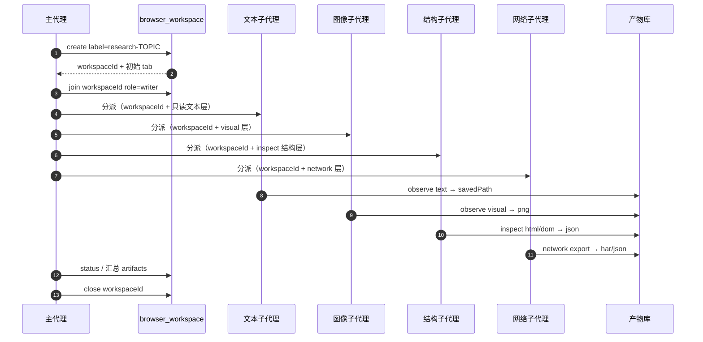

# 多子代理协作（subagents）

本文给**主代理**看：如何用 `browser_workspace` 把一次浏览器调研拆给多个子代理，并避免他们互相踩脚。

> 前提：`browser_workspace` 与 per-tab 锁已实现（真实 Edge 多代理 E2E 仍待 install-verify）。子代理应使用工作区与角色隔离；若运行环境暂未安装该 bundle，则至少用 `tab` 显式分工并在提示词里硬性约定。

## 为什么要工作区

多个子代理共享同一个 Chromium context。如果都操作「当前页」，会出现：

- 子代理 A 切走标签页，子代理 B 的快照引用失效；
- 两个子代理同时点不同按钮，页面状态互相覆盖；
- 图像子代理的截图截到了文本子代理刚滚动走的位置。

工作区提供四件事：**稳定标签页 + 角色权限 + 租约 + 交接**。

## 主代理的标准流程



### 1. 建工作区

```json
{ "action": "create", "label": "qcc-research-2026" }
```

拿到 `workspaceId`（如 `ws-7f3a`）和初始标签页 `t1`。主代理自己以 `writer` 加入：

```json
{ "action": "join", "workspaceId": "ws-7f3a", "role": "writer" }
```

### 2. 分派角色

| 子代理 | 角色 | 主要工具 | 产出 |
|---|---|---|---|
| 文本子代理 | `reader` | `browser_observe layers=["text","meta"]`、`browser_extract` | 正文分段、字段 JSON |
| 图像子代理 | `reader` | `browser_observe layers=["visual"]`、`browser_screenshot` | PNG 路径 + 尺寸 |
| 结构子代理 | `reader` | `browser_inspect dom/html/css/a11y/resources` | 结构报告 JSON/HTML |
| 网络子代理 | `reader` | `browser_network list/get/export` | 接口 JSON、HAR |
| 执行子代理（可选） | `writer` | `browser_act` | 动作 + 回读核验结果 |

默认给 `reader`。需要点击/填写的子代理才给 `writer`，且一次只给一个标签页。

### 3. 交接（handoff）

当写操作要换人（例如文本代理定位到按钮，执行代理来点）：

```json
{
  "action": "handoff",
  "workspaceId": "ws-7f3a",
  "tab": "t1",
  "toAgent": "agent-exec-01",
  "note": "已滚动到第 2 页表单；目标按钮 @e14；上一步已验证 URL 未变。"
}
```

`note` 必须包含：当前 URL、已完成动作、未完成目标、已知风险（验证码/限速/弹窗）。

### 4. 汇总与关闭

主代理用 `browser_workspace action=status` 和 `browser_status` 收集：

- 各子代理的 `artifacts` 路径；
- 失败/被阻断的 URL；
- 未处理的验证码或登录交接点。

汇总后 `close` 工作区；浏览器按 `idleCloseMs=0` 继续驻留。

## 权限模型

- `reader`：`browser_observe`、`browser_inspect`、`browser_extract`、`browser_screenshot`、`browser_network list/get`、`browser_status`。
- `writer`：reader 全部 + `browser_act`、`browser_tabs switch/close`、`browser_network start/stop`、`browser_collect`。
- `browser_download`、`browser_close` 建议只给主代理。
- reader 调用写工具 → 明确报错，不会静默降级。

## 冲突处理

| 场景 | 处理 |
|---|---|
| 两个 writer 抢同一标签页 | per-tab 写锁串行；后到者等待，超过 `lockTimeoutMs` 报错 |
| 快照引用失效 | 重新 `browser_observe`/`browser_snapshot`，不要猜引用 |
| 页面被导航走 | 重新解析 `tab`，确认 URL 后再操作 |
| 子代理 A 改了页面，B 的截图过期 | B 重新截图；交接 note 里写「页面已变更」 |
| 租约过期 | 重新 `join`；不要用过期 `workspaceId` 重试 |
| 浏览器崩溃 | 下一次调用自动重启；子代理从 checkpoint/artifact 恢复，不重放已完成动作 |

## 失败与重试

- 单次工具失败：读错误消息，最多重试 1 次；仍失败则**交回主代理**，不要连续重试。
- 批量采集：用 `jobId` + `cursor` + `checkpointPath` 续跑；`doneUrls` 保证不重复。
- 子代理超时：主代理用 `browser_workspace status` 看标签页 owner，必要时 `handoff` 收回。
- 验证码/登录：子代理停止写操作，把 `visibility=window` 的请求交给人；**不尝试绕过**。

## 产物路径汇总

所有产物都在 `artifactDir`（默认 `~/.dsh/browser-tool/artifacts`，或 `$DSH_HOME` 下的同名目录）：

| 类型 | 命名 | 用途 |
|---|---|---|
| 截图 | `shot-<ts>-<rand>.png` | 图像子代理、证据 |
| 观测 | `observe-<ts>-<rand>.txt/.json` | 文本/结构分层 |
| 提取 | `extract-<ts>-<rand>.txt/.json` | 超长正文 |
| 网络 | `network-<ts>-<rand>.har` | 接口审计 |
| 采集 | `collect-<ts>-<rand>.json` + `.checkpoint.json` | 批处理与续跑 |
| manifest | `manifest.jsonl` | 全部产物的账本 |

主代理汇总时只传**路径与摘要**，不要把所有内容塞回上下文。

## 可直接复制给子代理的提示词模板

```text
你是浏览器调研子代理，负责【文本 / 图像 / 结构 / 网络】层。

工作区：workspaceId = <ws-xxxx>，标签页 = <t1>，角色 = reader。
目标：<一句话目标，例如「提取该页面公司名称、信用代码、法定代表人」>。
禁止：不要新建标签页；不要点击提交/删除/购买；不要开启 eval；不要绕过验证码。
流程：
1. 先调用 browser_observe（layers 按你的分工取），确认 url/title 与 workspace 一致；
2. 需要更多内容时用 offset/limit 或 selector 分段，不要整页塞回；
3. 只读你的层，不操作其它子代理的标签页；
4. 结果落盘，返回 artifact 路径 + 3 行摘要 + 未完成项；
5. 遇到验证码/登录/风控，立即停止并报告「需要人工」。
验收：摘要能独立说明读到了什么；路径可被 read_image / read 打开；没有未核验的结论。
```

## 主代理自检清单

- [ ] `browser_workspace create` 成功，`workspaceId` 已写入每个子代理提示词
- [ ] 只给需要的子代理 `writer`，且限定标签页
- [ ] 子代理提示词包含「不自动提交 / 不绕验证 / 只读自己的层」
- [ ] 交接 `note` 写了 URL、已完成动作、未完成目标
- [ ] 汇总时核对 `artifacts` 路径与 manifest
- [ ] 失败项有明确归属（重试 / 交回 / 交人）
